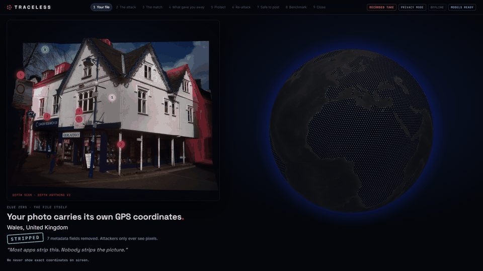
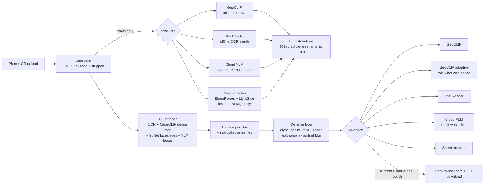
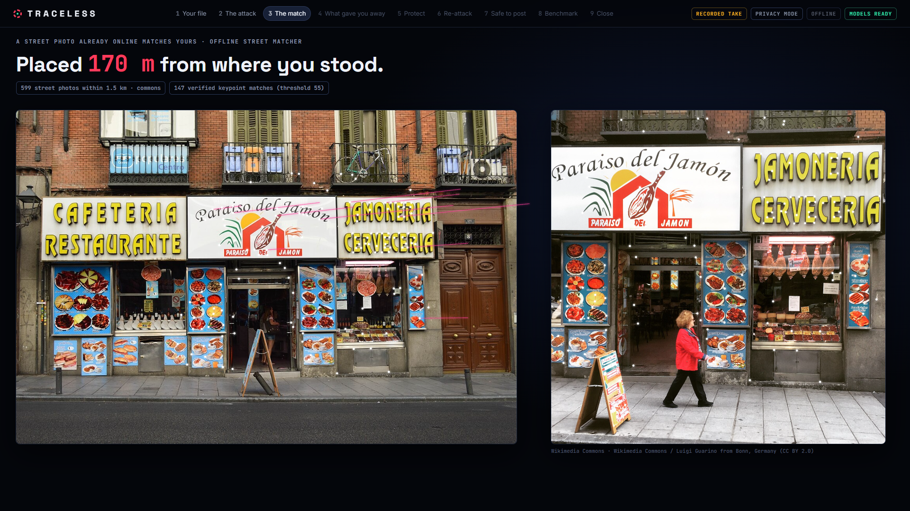

# TRACELESS

> **See what a stalker's AI sees in your photo — then make it unplaceable.**



You hand over a photo you're about to post. TRACELESS shows what an AI geolocator reads
from the **pixels alone** — sign text, architecture, vegetation, road markings,
reflections — while a globe shows the guess collapsing from country to street as each
clue is found. Then it erases those clues, attacks the photo again with *different* AIs
(one of them told the photo was edited), and proves — with numbers — that it can no
longer be placed. You get the protected photo back on your phone.

**Track 2 — Make the Invisible Visible.** The interesting part is what happens after
detection: TRACELESS detects the clues, removes them, and *measures* that the removal worked.

---

## The threat

- **2019, Japan:** a man found a pop idol's home from the reflection in her pupils in a
  selfie she posted — he matched the reflected station with Street View
  ([NBC News / AP, Oct 2019](https://www.nbcnews.com/news/world/stalking-suspect-allegedly-studied-pop-idol-s-pupil-images-online-n1064916);
  [SCMP, Feb 2020](https://www.scmp.com/week-asia/people/article/3052704/japanese-sex-pest-jailed-stalking-pop-idol-ena-matsuoka-using)).
- **AI does it in seconds now.** GeoSpy geolocates photos from pixels and is sold to police
  ([404 Media, Jan 2025](https://www.404media.co/the-powerful-ai-tool-that-cops-or-stalkers-can-use-to-geolocate-photos-in-seconds/);
  [Feb 2026](https://www.404media.co/cops-are-buying-geospy-ai-that-geolocates-photos-in-seconds/)).
  In April 2025 "reverse location search" with ChatGPT o3 went viral
  ([TechCrunch](https://techcrunch.com/2025/04/17/the-latest-viral-chatgpt-trend-is-doing-reverse-location-search-from-photos/)).
- **Stripping location data doesn't help.** Every platform strips EXIF/GPS. The picture
  itself is the leak — and nobody strips the picture.

## What TRACELESS does

1. **Clue zero** — reads the file's EXIF/GPS, shows it, strips it. GPS is never attack
   input; it's only the answer key for measuring distance error.
2. **The attack (pixels only)** — three attacker families, two of them fully offline:
   - **GeoCLIP** (offline, GPS-retrieval; NeurIPS 2023) on the laptop,
   - **The Reader** (offline, symbolic): OCR → gazetteer, scripts, diacritics, phone codes, web domains,
   - **a frontier vision model** (optional, cloud) with a strict JSON schema, 3 calls for a spread,
   - **a street matcher** (offline, Attacker C): visual place recognition (EigenPlaces) over
     geotagged street photos of the area, re-ranked by SuperPoint + LightGlue keypoints and
     RANSAC — it pins the exact corner, and draws the real matched keypoints as lines.
3. **Which clues gave you away** — every clue's contribution is **measured by ablation**
   (erase only that clue, attack again, compare the 90% search area). The globe's
   country→street collapse is real data: all clues erased, then restored one at a time.
4. **Erase** — the least destructive fix per clue: glyph-level LaMa inpainting for signs
   (the board stays, the words go), inpainting for landmarks/flags, blur for small text and
   plates, softening for reflections. **The person is never altered** (eyes softened only) —
   measured: face pixels changed = 0.
5. **Re-attack** with different AIs — including an **adaptive** attacker that is *told
   which pixels were edited* and zooms into everything left untouched — until every
   attacker misses by more than the radius (default 25 km), or we say we couldn't.
6. **Safe to post** — QR → the protected photo on your phone, plus a card: before/after
   distance, search-area growth, % pixels changed, location data stripped.

## How it works



Distributions live on an **H3 grid** (one fixed resolution, so before/after areas are
comparable); "credible area" = area of the smallest hexagon set holding 90% of the
probability. Details and every trade-off: [DECISIONS.md](DECISIONS.md).

## Results

All numbers below are generated by scripts and injected with `scripts/update_readme.py` —
nothing is hand-typed. "Can't be placed" always means **not within the radius, by the
attackers listed**.

### Benchmark — Im2GPS3k (`make bench`)

_Code version: these tables come from the 03:47 run — GeoCLIP, GeoCLIP-adaptive and The Reader
on the cities15000 gazetteer. They predate the cities5000 Reader upgrade (D24) and the street
matcher, so The Reader row likely understates it on small-town signs. A re-run on the current
code was started but stopped: with the demo server sharing the 6 GB GPU it ran at ~90 s/photo.
`make bench` reproduces it on an idle GPU (~45 min)._

Offline attackers only (the cloud attacker costs credits; Attacker C needs street coverage
of each test location, which Im2GPS3k's worldwide photos don't have). "Already hard to
place" photos are counted with after = before. Honest reading: protection cuts
GeoCLIP's city-level hit rate by about 40% (33.7% → 20.3%) at a median ~20% of pixels changed; it does not make every
photo unplaceable — famous, heavily-photographed scenes resist. These tables were measured
before The Reader's gazetteer upgrade (cities15000 → cities5000, DECISIONS D24), so its row
under-reports what the current Reader reads; a full re-run did not fit the build window.

<!-- BENCH:START -->
_Generated by `python bench/run_bench.py --n 300 --clue-rich 100` on 2026-10-25 (NVIDIA GeForce RTX 3050 6GB Laptop GPU). Radius 25 km._

**Random subset (seed 0, first 300)** — n = 300 of 300 attempted; 199 already hard to place; 101 defended, 33 reached the 25 km target. LPIPS 0.0486, SSIM 0.909, median pixels changed 19.54%.

| attacker | ≤1 km | ≤25 km | ≤200 km | ≤750 km | ≤2500 km | median error | median 90% area |
|---|---|---|---|---|---|---|---|
| GeoCLIP (offline) | 14.0% → **8.0%** | 33.7% → **20.3%** | 48.3% → **39.3%** | 68.7% → **62.3%** | 82.0% → **77.3%** | 232 km → **378 km** | 5,866 → **7,128** km² |
| GeoCLIP adaptive (told what was edited) | 13.0% → **8.7%** | 31.3% → **22.7%** | 48.3% → **41.7%** | 68.3% → **63.7%** | 82.0% → **78.7%** | 233 km → **346 km** | 34,528 → **41,285** km² |
| The Reader (OCR sleuth) | 0.0% → **0.0%** | 1.0% → **0.0%** | 1.0% → **0.0%** | 1.3% → **0.3%** | 2.3% → **1.7%** | 1,975 km → **2,160 km** | 226,439 → **226,439** km² |

**Clue-rich subset (>= 2 confident OCR lines)** — n = 100 of 100 attempted; 57 already hard to place; 43 defended, 14 reached the 25 km target. LPIPS 0.0726, SSIM 0.8913, median pixels changed 21.24%.

| attacker | ≤1 km | ≤25 km | ≤200 km | ≤750 km | ≤2500 km | median error | median 90% area |
|---|---|---|---|---|---|---|---|
| GeoCLIP (offline) | 23.0% → **17.0%** | 42.0% → **26.0%** | 55.0% → **41.0%** | 74.0% → **64.0%** | 84.0% → **78.0%** | 149 km → **395 km** | 4,048 → **6,361** km² |
| GeoCLIP adaptive (told what was edited) | 23.0% → **16.0%** | 43.0% → **29.0%** | 56.0% → **45.0%** | 72.0% → **65.0%** | 86.0% → **81.0%** | 108 km → **295 km** | 15,753 → **20,627** km² |
| The Reader (OCR sleuth) | 0.0% → **0.0%** | 5.0% → **0.0%** | 5.0% → **0.0%** | 8.0% → **1.0%** | 14.0% → **8.0%** | 4,680 km → **5,379 km** | 41,153 → **84,768** km² |
<!-- BENCH:END -->

### Fixture photos (`scripts/run_fixtures.py`)

<!-- FIXTURES:START -->
_Generated by `scripts/run_fixtures.py` on 2026-10-25 (NVIDIA GeForce RTX 3050 6GB Laptop GPU), offline attackers only, radius 25 km._

| fixture | type | GeoCLIP before | GeoCLIP after / adaptive | 25 km target | pixels changed / SSIM | attack / ablation / defense time |
|---|---|---|---|---|---|---|
| abergavenny-book-shop | street_text | 21 km | 89 km / adaptive 97 km | ✅ reached | 21.6% / 0.896 | 42.1s / 9.8s / 34.0s |
| madrid-jamon-shopfront | street_text | 0.9 km | 0.9 km / adaptive 0.9 km | ⚠️ not reached | 31.9% / 0.774 | 4.6s / 9.7s / 23.6s |
| osaka-dotonbori-signs | street_text | 0.0 km | 0.0 km / adaptive 0.0 km | ⚠️ not reached | 22.2% / 0.869 | 6.0s / 6.7s / 50.0s |
| cincinnati-main-st | street_text | 0.3 km | 0.4 km / adaptive 0.4 km | ⚠️ not reached | 24.1% / 0.863 | 3.2s / 1.8s / 47.0s |
| paris-eiffel-tower | landmark | 0.2 km | 0.4 km / adaptive 3,203 km | ⚠️ not reached | 23.9% / 0.871 | 3.1s / 4.0s / 20.6s |
| iowa-rural-blacktop | rural | 307 km | already hard to place | — | — | 3.2s / 4.9s / 0.0s |
| bigsur-pfeiffer-beach | nature | 0.0 km | 0.0 km / adaptive 0.0 km | ⚠️ not reached | 18.3% / 0.914 | 2.6s / 2.1s / 35.4s |
| berlin-shopwindow-reflection | reflective | 425 km | already hard to place | — | — | 2.6s / 4.8s / 0.0s |
| tyumen-portrait | portrait | 2,385 km | already hard to place | — | — | 3.8s / 8.9s / 0.0s |
| depew-suburban-street | suburban | 307 km | already hard to place | — | — | 2.9s / 9.5s / 0.0s |
| indoor-sunny-apartment | indoor | 10,156 km | already hard to place | — | — | 2.9s / 2.2s / 0.0s |
<!-- FIXTURES:END -->

### Street-level pinpoint — when does a match count? (`bench/street_threshold.py`)

Attacker C only claims a street-level match when the best reference photo shares at least
**T** RANSAC-verified keypoints with yours, and only inside the downloaded coverage (whose size
is always on screen). T is measured, not chosen: the smallest count above every out-of-coverage
negative with ≥ 95% of in-coverage claims correct (leave-one-out).



<!-- STREET:START -->
Measured on the `madrid-test` reference set (600 commons photos): threshold **T = 55 inliers** (max on 50 out-of-coverage negatives: 45). Leave-one-out on 120 in-coverage queries: recall@1 within 25 m **43%**, within 100 m **49%**; precision of claims within 100 m 95% (62 claims).
<!-- STREET:END -->

### Eye reflections — when can one actually be read? (`make iris`)

Truth rule: we only *claim* an eye reflection is readable when the iris is large enough
in pixels; below that, eyes (and sunglasses, windows, car bodies, mirrors) are flagged
as **possible clues** and softened as a labeled precaution.

<!-- IRIS:START -->
Measured threshold: **96 px** iris diameter (found). Criterion: smallest iris diameter where >=50% of scenes are readable (GeoCLIP same place within 25 km, or OCR reads a scene word), holding for every larger size. Simulation: convex-mirror reflection, 65% over synthetic iris, JPEG q85, attacker upsamples 4x (attacker-favourable). Scenes: 6 fixtures.

| iris diameter | readable (either) | GeoCLIP same place | OCR reads a word |
|---|---|---|---|
| 8 px | 0% | 0% | 0% |
| 12 px | 0% | 0% | 0% |
| 16 px | 17% | 17% | 0% |
| 24 px | 17% | 17% | 0% |
| 32 px | 17% | 17% | 0% |
| 48 px | 17% | 17% | 0% |
| 64 px | 33% | 33% | 0% |
| 96 px | 50% | 50% | 0% |
| 128 px | 50% | 50% | 0% |
| 192 px | 67% | 67% | 0% |
<!-- IRIS:END -->

### CLOAK — what invisible adversarial noise does (`bench/cloak.py`, README-only)

PGD on GeoCLIP's image encoder (30 steps, L∞ ε = 2/255 and 4/255), pushing probability away
from GeoCLIP's own first guess. Against the model it was optimised on it is devastating and
invisible (LPIPS ≤ 0.08) — even the "memorised" famous scenes move thousands of km. But read
the second column carefully: the "adaptive" attacker is the *same model* looking through
different crops, and the noise only partly survives that; it says nothing about a different
model family (a cloud VLM, a street matcher, a human). That is why TRACELESS ships visible,
auditable erasure as the protection and keeps CLOAK as a measured footnote.

<!-- CLOAK:START -->
| photo | ε | GeoCLIP (white-box) | GeoCLIP adaptive (transfer) | LPIPS | SSIM |
|---|---|---|---|---|---|
| abergavenny-book-shop | 2/255 | 21 km → **475 km** | 21 km → **475 km** | 0.0074 | 0.9917 |
| abergavenny-book-shop | 4/255 | 21 km → **475 km** | 21 km → **475 km** | 0.0252 | 0.9729 |
| madrid-jamon-shopfront | 2/255 | 0.9 km → **506 km** | 0.9 km → **506 km** | 0.0041 | 0.9947 |
| madrid-jamon-shopfront | 4/255 | 0.9 km → **506 km** | 0.9 km → **506 km** | 0.0121 | 0.9835 |
| osaka-dotonbori-signs | 2/255 | 0.0 km → **397 km** | 0.0 km → **0.0 km** | 0.0117 | 0.9915 |
| osaka-dotonbori-signs | 4/255 | 0.0 km → **397 km** | 0.0 km → **0.2 km** | 0.0342 | 0.9726 |
| cincinnati-main-st | 2/255 | 0.3 km → **1,052 km** | 0.4 km → **0.4 km** | 0.0061 | 0.9941 |
| cincinnati-main-st | 4/255 | 0.3 km → **1,052 km** | 0.4 km → **1,052 km** | 0.0179 | 0.9806 |
| paris-eiffel-tower | 2/255 | 0.2 km → **8,751 km** | 0.3 km → **0.2 km** | 0.0217 | 0.9889 |
| paris-eiffel-tower | 4/255 | 0.2 km → **8,751 km** | 0.3 km → **8,751 km** | 0.0772 | 0.9567 |
| iowa-rural-blacktop | 2/255 | 307 km → **1,595 km** | 307 km → **190 km** | 0.0049 | 0.9924 |
| iowa-rural-blacktop | 4/255 | 307 km → **1,599 km** | 307 km → **769 km** | 0.0162 | 0.9757 |
| bigsur-pfeiffer-beach | 2/255 | 0.0 km → **7,040 km** | 0.0 km → **7,040 km** | 0.0121 | 0.992 |
| bigsur-pfeiffer-beach | 4/255 | 0.0 km → **8,139 km** | 0.0 km → **8,139 km** | 0.0387 | 0.9732 |
| berlin-shopwindow-reflection | 2/255 | 425 km → **1,950 km** | 635 km → **1,950 km** | 0.0204 | 0.9947 |
| berlin-shopwindow-reflection | 4/255 | 425 km → **1,950 km** | 635 km → **1,950 km** | 0.0573 | 0.9825 |
| tyumen-portrait | 2/255 | 2,385 km → **11,011 km** | 2,360 km → **11,011 km** | 0.0097 | 0.9878 |
| tyumen-portrait | 4/255 | 2,385 km → **11,265 km** | 2,360 km → **11,265 km** | 0.0398 | 0.9572 |
| depew-suburban-street | 2/255 | 307 km → **231 km** | 327 km → **231 km** | 0.0042 | 0.9959 |
| depew-suburban-street | 4/255 | 307 km → **3,169 km** | 327 km → **3,169 km** | 0.0134 | 0.9855 |
<!-- CLOAK:END -->

### Why not just invisible adversarial noise? (CLOAK, `bench/cloak.py`)

We built it and measured it. PGD on GeoCLIP's image encoder (30 steps, L∞ ε = 2/255 or
4/255) moves **GeoCLIP itself** hundreds to thousands of km on every fixture at LPIPS ≈ 0.01
(e.g. Madrid 0.95 → 506 km, Eiffel Tower 0.23 → 8,751 km). But it is brittle:
the same model's adaptive close-up crops still placed Osaka at 0.01 km and Cincinnati at
0.43 km at ε = 2/255, and against a **different model family** it does nothing — the street
matcher still pins Madrid 170 m away with ~140 verified keypoints, and The Reader still
reads the signs. Noise fools the model it was tuned on; erasing the clue removes it for
everyone. Full table: [bench/results/CLOAK.md](bench/results/CLOAK.md). (At ε = 2/255 the
"pixels changed" metric reads 0% because its threshold is > 2/255 — the noise is below it.)

## Truth rules, and how the code enforces them

| rule | enforcement |
|---|---|
| Location data is clue zero, never attack input | `exif.load_clean()` re-materializes pixels into a fresh image; attackers only receive that. Tested in `tests/test_exif.py`. |
| Eye reflections only claimed above a measured threshold | `bench/iris_threshold.py` → `data/iris_threshold.json` → `clues/faces.py`. Unmeasured ⇒ never claimed. |
| Every number is from this run | the web app only renders API state; counters animate between real values; README blocks are generated. |
| Contributions by ablation, never invented | `ablation.py`: erase one clue → re-attack → `log10(area_without / area_with)`. |
| "Can't be placed" = radius + attackers | `defense/loop.verdict()` always names both. |
| No "locate any photo" mode; projector privacy | regions + distances by default, globe zoom floor, no pin; exact places only for public landmarks or owner's OK (M). |
| The person is never altered | person mask hard-restored every round; `face_pixels_changed` measured (0 on every fixture). |
| Photos stay on the laptop | only metadata-stripped, re-encoded JPEGs go to the optional cloud attacker; Shift+W / `/api/wipe` deletes everything. |

## Limitations & ethics

- **Dual use.** Showing what leaks is also a lesson in how to look. TRACELESS has no
  "locate any photo" mode: it protects a photo you upload, shows the attack as a risk
  report, and hides coordinates on the projector unless it's a public landmark.
- **What it can't stop:** a human with extra context (your other posts, captions,
  friends' photos, the time you posted), matching against your *other* photos, or a
  future attacker stronger than the ones we tested. Results are "by the attackers we tested".
- **Iconic scenes** (e.g. Dotonbori, the Champ de Mars) are landmarks *as a whole*; GeoCLIP's
  Flickr-derived prior also favours famous places. We report "target not reached"
  rather than wrecking the photo — the 35% repaint budget is a hard cap.
- **Dense clue map is coarse** (14-px patches; ClearCLIP on CLIP-L instead of a separate
  detector + SAM 2 — a disk-budget trade-off, see DECISIONS D3). Text masks are pixel-accurate.
- Fixture photos are Wikimedia Commons uploads, some from Flickr, so retrieval models may
  have seen near-duplicates; the benchmark uses the standard held-out Im2GPS3k set.

## Prior art

We checked for products that remove location clues from **image content** (not just
metadata): Apple Photos' location controls, metadata-stripper apps, Proton's EXIF guide,
Glaze/Fawkes (art/face cloaking) — all metadata-only or a different threat. **We found
no consumer product that does this.** Research is active:

- Mendes et al., *Granular Privacy Control for Geolocation with VLMs*, EMNLP 2024 — moderates model answers, not images.
- Luo et al., *Doxing via the Lens*, ICLR 2026 — attack benchmark (DoxBench).
- Liu et al., *GeoShield*, AAAI 2026 — adversarial noise against VLM geolocation.
- Wang et al., *Hiding in Plain Sight*, NDSS 2027 — diffusion-latent perturbations (GeoCLIP as proxy).
- Yan et al., *GeoEdit* (arXiv 2610.26194, Oct 2026) and Shi et al., *GeoShift* (arXiv 2610.30439, Oct 2026) — editing-based de-evidencing; the closest work.

TRACELESS's angle: an end-to-end tool a person can use on the photo they're about to
post, that runs **offline**, explains **which clue** gave them away with **measured**
contributions, makes only **visible, auditable** edits (no adversarial noise that fools one
model), and verifies against **different attacker families**, including one told what was edited.

Geolocation models: GeoCLIP ([Vivanco et al., NeurIPS 2023](https://arxiv.org/abs/2309.16020)),
PIGEON ([Haas et al., CVPR 2024](https://arxiv.org/abs/2307.05845)); benchmark Im2GPS3k
([Vo, Jacobs & Hays, ICCV 2017](https://arxiv.org/abs/1705.04838)).

## Built with Devin

This repo runs a split-brain workflow (see [CLAUDE.md](CLAUDE.md)): **Claude Code** is
the builder (all code, tests, benchmarks), **Devin** is the committer and reviewer — it
watches for `DEVIN_COMMIT_READY:` handoffs, reviews each diff, and authors every commit.
Lanes from the brief map to modules: attack (`attackers/`), defense + loop (`defense/`,
`ablation.py`), frontend (`web/`), benchmark (`bench/`), hardening (`takes`, SIM mode,
`SETUP.md`). Devin also acted as product lead mid-build: it committed
[UPGRADE.md](UPGRADE.md) (Attacker C, the six shots, stage-direction rules), and the
builder answered with [UPGRADE_PLAN.md](UPGRADE_PLAN.md) and shipped against it. Every
commit in `git log` is authored by Devin from a builder handoff; decisions and their
measurements are in [DECISIONS.md](DECISIONS.md).

## Quickstart

```bash
make setup     # backend venv, model weights (~0.9 GB), web build
make demo      # http://localhost:8000 — scan the QR with your phone, or click a SIM photo
make test      # unit tests;  make test-golden  runs the full pipeline on every fixture
make bench     # Im2GPS3k benchmark -> bench/results/ -> README
```

More: [SETUP.md](SETUP.md) (≤2-minute demo setup, Wi-Fi-off mode) · [DEMO.md](DEMO.md)
(3-minute script) · [HARDWARE_TEST.md](HARDWARE_TEST.md) · [DECISIONS.md](DECISIONS.md).

## Credits

Fixture photos: Wikimedia Commons contributors — see [fixtures/ATTRIBUTION.md](fixtures/ATTRIBUTION.md).
GeoCLIP (MIT), LaMa (Apache-2.0), RapidOCR / PaddleOCR (Apache-2.0), OpenCV YuNet (MIT),
GeoNames (CC-BY 4.0), globe.gl (MIT), Natural Earth (public domain), EigenPlaces (MIT),
LightGlue + SuperPoint (Apache-2.0 / research weights), Depth Anything V2 Small (Apache-2.0).
Street reference photos: Mapillary contributors (CC BY-SA 4.0) when built from Mapillary;
Wikimedia Commons contributors (per-file licenses, credited on screen) otherwise.
